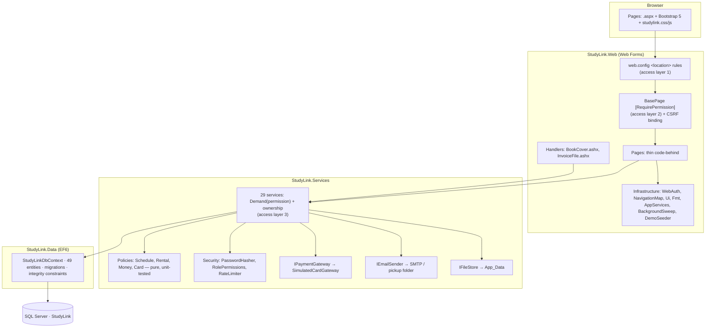
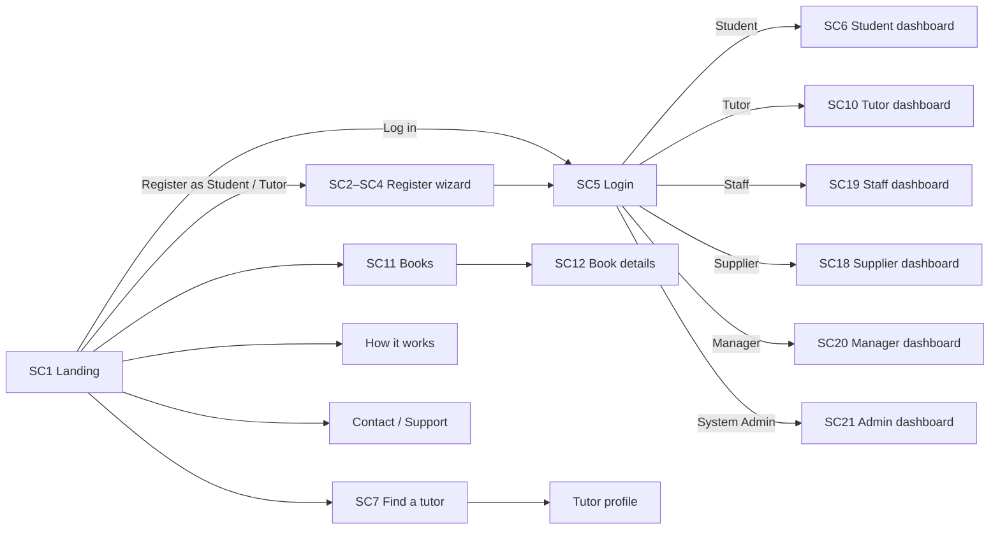
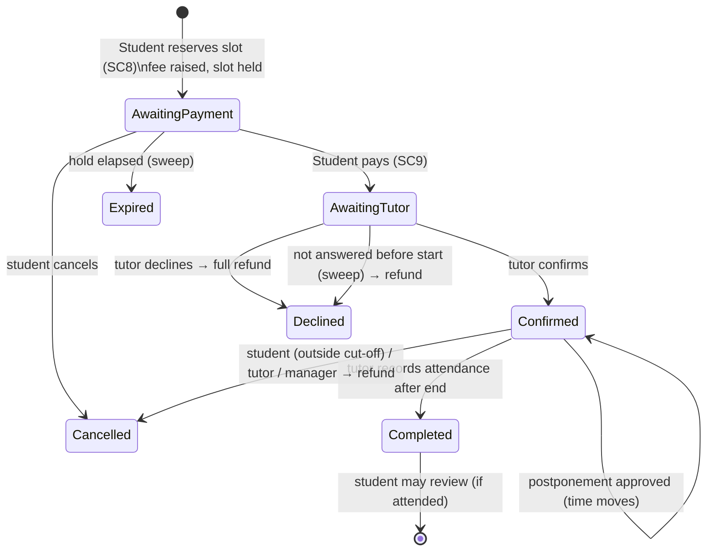
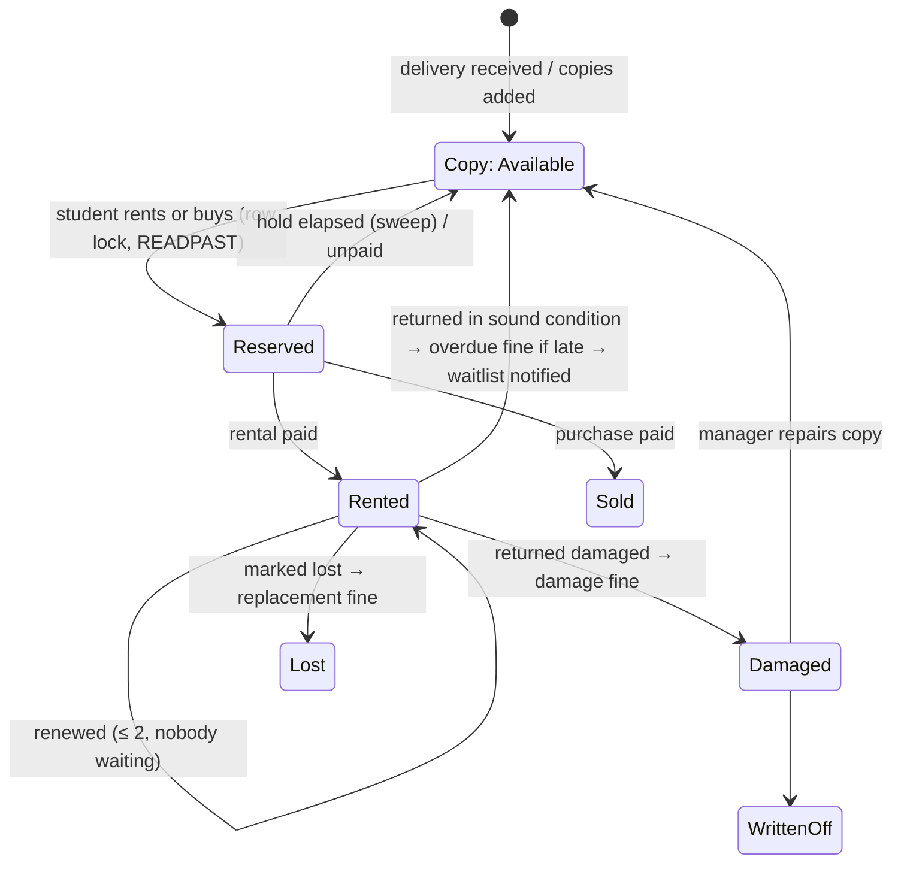
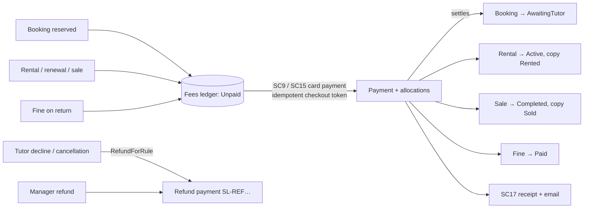
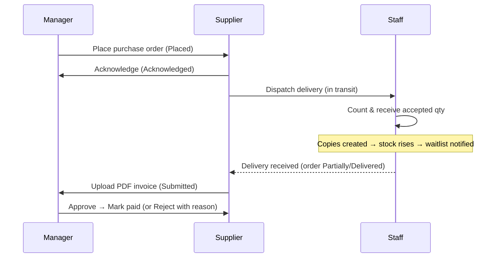
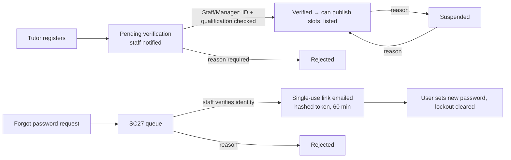

# StudyLink — System Overview, Audit and Use Cases

**StudyLink – Books, Tutoring & Academic Resource Hub** · *Bringing students and tutors together.*
Built by Nova Tech Developers (UFH IFS303) for Forte Books & Tuition Hub · campuses Alice, East London and Bisho.

This document comes from a full read of the codebase: data model, every service and every page. It records:

* how the system is built,
* how each role moves through it,
* every use case, with a narrative,
* what is verified working, and what is broken or missing.

Audit date: **1 October 2026**, at commit `13d86ad` plus the audit fixes listed in §9.2.

---

## Contents

1. [At a glance](#1-at-a-glance)
2. [Architecture](#2-architecture)
3. [Roles and permissions](#3-roles-and-permissions)
4. [User navigation](#4-user-navigation)
5. [System workflows](#5-system-workflows)
6. [Use case catalogue](#6-use-case-catalogue)
7. [Use case narratives](#7-use-case-narratives)
8. [Business rules](#8-business-rules)
9. [What works, what was broken, what is open](#9-what-works-what-was-broken-what-is-open)
10. [Code review by layer](#10-code-review-by-layer)
11. [Data model](#11-data-model)
12. [Testing](#12-testing)
13. [Recommendations](#13-recommendations)

---

## 1. At a glance

| | |
|---|---|
| Platform | ASP.NET Web Forms, C# 7.3, .NET Framework 4.8.1, IIS Express / IIS |
| Data | SQL Server 2022 (Express), Entity Framework 6.5 Code First, one `InitialCreate` migration |
| Solution | 4 projects: `StudyLink.Web`, `StudyLink.Services`, `StudyLink.Data`, `StudyLink.Tests` |
| Size | 68 pages, 2 handlers, 3 master pages, 1 user control · about 5,000 lines of service code · 49 tables |
| Roles | Student, Tutor, Staff, Supplier, Manager, System Admin |
| Screens | SC1–SC17 (Sprint 1) and SC18–SC28 (new), all implemented |
| Build | MSBuild: 0 errors, 0 warnings. `aspnet_compiler` precompiles every page cleanly. |
| Tests | 48 unit and integration tests, plus 9 HTTP tests against the running site. Results are in §12. |
| Overall status | **Feature-complete for the brief.** The audit found 10 defects, all fixed (§9.2). Seven design gaps or limitations remain (§9.3); none blocks the main flows. |

---

## 2. Architecture

**Design decisions** (from the decision record D-1 to D-6):

* **Web Forms in C#.** Each brief "controller + view" is a page with a thin code-behind that calls a service. No business rule lives in a page.
* **Authentication** is a port of TutorConnect's own: PBKDF2-SHA256 at 100,000 iterations, lockout, rate limiting. The Forms ticket carries only the user id; roles and the active flag are re-read from the database on every request.
* **EF6 Code First.** Race-critical paths use raw SQL locks (`UPDLOCK, HOLDLOCK` / `READPAST`), with filtered unique indexes as a backstop.
* **Booking order:** pay first, then the tutor confirms. A decline refunds.
* **Payments** go through a simulated card gateway behind an interface. Only the card brand and last four digits are stored.
* **Composition root:** `StudyLinkServices` builds every service around one `DbContext` per request. Tests build the same object directly.
* **One permission matrix** (`RolePermissions`) drives page guards, menus and service checks.

---

## 3. Roles and permissions

Self-registration is open to **Student** and **Tutor** only. Tutors start as *Pending verification*. Staff, Supplier, Manager and System Admin accounts are created by an Admin or a Manager. The table below is generated from `Services/Security/Permissions.cs`, the single source of truth.

| Permission | Student | Tutor | Staff | Supplier | Manager | Sys Admin |
|---|:-:|:-:|:-:|:-:|:-:|:-:|
| BookTutoring, RentOrBuyBooks, PayFees, ReviewTutors | ✔ | | | | | |
| ManageAvailability, RespondToBookings, SubmitTimesheet | | ✔ | | | | |
| VerifyTutors, CaptureStudents, ProcessReturns, ManageFines | | | ✔ | | ✔ | |
| ReviewTimesheets, ReceiveDeliveries, ViewOperationalReports | | | ✔ | | ✔ | |
| HandleSupport | | | ✔ | | ✔ | ✔ |
| HandlePasswordResets | | | ✔ | | | ✔ |
| SupplierPortal | | | | ✔ | | |
| ManageBooks, ManagePayments, ManageSupplierOrders, ReviewInvoices | | | | | ✔ | |
| ViewAllReports | | | | | ✔ | |
| CreateStaffAndSuppliers | | | | | ✔ | ✔ |
| ManageSubjects, ModerateReviews | | | | | ✔ | ✔ |
| ManageAllUsers, AssignRoles, ManageSettings, ManageSecurity, ManageBackups, ViewAuditLogs | | | | | | ✔ |

**Who can create which accounts:**
* **Admin:** Manager, Staff, Supplier, System Admin and Student.
* **Manager:** Staff, Supplier and Student.
* **Staff:** Student only (captured at the counter).

**Three enforcement layers**, verified by the HTTP role matrix tests:
1. **`web.config` folder rules.** `Student/`, `Tutor/`, `Staff/`, `Supplier/`, `Manager/` and `Admin/` are open to that role only. `Operations/` is open to Staff, Manager and System Admin.
2. **The page guard.** `[RequirePermission(...)]` on each page, checked in `BasePage.OnInit`.
3. **The services.** `RolePermissions.Demand(...)` plus ownership checks. For example, someone else's booking looks exactly like a missing one.

---

## 4. User navigation

Every signed-in page uses the **App** shell:
* a navy sidebar with the role menu, plus a "More" section for extra operational screens;
* a top bar with the notification bell;
* a page header band;
* on phones, a bottom tab bar with four items, as in the Sprint 1 mockups.

Anonymous pages use the **Public** shell. Login and registration use the **Auth** shell.

### Menus by role (brief §8)

| Role | Sidebar (primary) | "More" | Mobile tabs |
|---|---|---|---|
| **Student** | Home · Books · Tutoring · My Bookings · My Rentals · Fees & Payments · Profile | – | Home · Books · Fees · Profile |
| **Tutor** | Home · Schedule · Availability · Sessions · Attendance · Timesheets · Earnings · Profile | – | Home · Schedule · Timesheets · Profile |
| **Staff** | Home · Tutor Verification · Students · Returns · Fines · Support · Profile | Password Resets · Timesheets · Deliveries · Reports | Home · Tutor Verification · Returns · Profile |
| **Supplier** | Home · Orders · Deliveries · Invoices · Stock · Profile | – | Home · Orders · Invoices · Profile |
| **Manager** | Home · Books · Inventory · Payments · Rentals · Reports · Staff · Suppliers · Profile | Tutor Verification · Timesheets · Deliveries · Fines · Categories · Subjects · Reviews · Support | Home · Books · Reports · Profile |
| **System Admin** | Home · Users · Roles · System Settings · Audit Logs · Security · Backups · Profile | Password Resets · Subjects · Reviews · Support | Home · Users · Audit Logs · Profile |

### Page map

| Area | Pages |
|---|---|
| Public | `Default` (SC1) · `Catalogue/Books` (SC11) · `Catalogue/BookDetails` (SC12) · `Catalogue/Tutors` (SC7) · `Catalogue/TutorProfile` · `Public/HowItWorks` · `Public/Contact` · `Public/Privacy` |
| Account | `Login` (SC5) · `Register` (SC2–SC4) · `ForgotPassword` · `ResetPassword` · `ChangePassword` · `Setup` · `Profile` · `AccessDenied` |
| Student | `Dashboard` (SC6) · `Tutoring/SelectSlot` (SC8) · `Payments/Checkout` (SC9) · `Tutoring/BookingConfirmed` (SC16) · `Tutoring/MyBookings` · `Tutoring/BookingDetails` · `Books/MyRentals` · `Books/RentalConfirmed` (SC13) · `Fees/MyFees` (SC14) · `Fees/PayFees` (SC15) · `Fees/PaymentComplete` (SC17) |
| Tutor | `Dashboard` (SC10) · `Schedule` (`?view=requests` = Sessions, `?view=past` = Attendance) · `SessionDetails` · `Availability` · `Subjects` · `Timesheet` · `Earnings` · `Reviews` |
| Staff / Operations | `Staff/Dashboard` (SC19) · `TutorVerification` (SC22) · `Users` (SC23) · `Reports` (SC24) · `PasswordResets` (SC27) · `Returns` · `Fines` · `Support` · `Timesheets` · `Deliveries` · `Subjects` · `Reviews` |
| Supplier | `Dashboard` (SC18) · `Orders` · `OrderDetails` · `Deliveries` · `Invoices` · `Stock` |
| Manager | `Dashboard` (SC20) · `Books` (SC25, `?view=inventory`) · `BookEdit` · `Categories` · `Payments` · `SupplierOrders` (SC26: orders / new / invoices) |
| Admin | `Dashboard` (SC21) · `Roles` · `Settings` · `Security` · `Backups` · `AuditLog` (SC28) |
| Shared | `Notifications/Index` · `ErrorPages/Error404`, `Error500` · `Handlers/BookCover.ashx`, `InvoiceFile.ashx` |

---

## 5. System workflows

### 5.1 Tutoring booking lifecycle (D-4)

### 5.2 Textbook rental and sale lifecycle

### 5.3 Money: fees, payments and refunds

### 5.4 Supply chain (SC26 ↔ SC18)

### 5.5 Accounts: tutor verification and password reset

### 5.6 Hourly maintenance sweep (`MaintenanceService`)

Each step is idempotent:
1. Expire unpaid booking holds.
2. Decline and refund paid bookings the tutor never answered.
3. Release unpaid rental and sale holds.
4. Send due-tomorrow, overdue (day 1, then weekly) and session-tomorrow reminders, de-duplicated by key.
5. Raise low-stock alerts to managers (one per title per day).
6. Snapshot `DailyMetrics` for yesterday and today.
7. Refresh `TutorStats`.

---

## 6. Use case catalogue

| ID | Use case | Primary actor | Screens | Status |
|---|---|---|---|---|
| UC-01 | Browse the landing page and choose a campus | Visitor | SC1 | ✅ |
| UC-02 | Browse and search textbooks | Visitor / Student | SC11, SC12 | ✅ |
| UC-03 | Find a tutor and view their profile | Visitor / Student | SC7, profile | ✅ |
| UC-04 | Send a support message | Visitor / any | Contact | ✅ |
| UC-05 | Register as a student | Visitor | SC2–SC4 | ✅ |
| UC-06 | Register as a tutor | Visitor | SC2–SC4 | ✅ |
| UC-07 | Sign in and sign out | Everyone | SC5 | ✅ |
| UC-08 | Reset a forgotten password | Everyone + Staff | ForgotPassword, SC27, ResetPassword | ✅ |
| UC-09 | Manage own profile and password | Everyone signed in | Profile, ChangePassword | ✅ |
| UC-10 | Read notifications | Everyone signed in | Bell, Notifications | ✅ |
| UC-11 | Book a tutoring session | Student | SC7 → SC8 → SC9 → SC16 | ✅ |
| UC-12 | Pay fees | Student | SC9, SC14, SC15, SC17 | ✅ |
| UC-13 | Cancel a session | Student / Tutor | BookingDetails, SessionDetails | ✅ |
| UC-14 | Request or withdraw a postponement | Student | BookingDetails | ✅ |
| UC-15 | Review a completed session | Student | BookingDetails | ✅ |
| UC-16 | Rent a textbook | Student | SC11 → SC12 → SC9 → SC13 | ✅ |
| UC-17 | Buy a textbook | Student | SC12 → SC9 → SC13 | ✅ |
| UC-18 | Join or leave a waitlist | Student | SC12, MyRentals | ✅ |
| UC-19 | Renew a rental | Student | MyRentals | ✅ |
| UC-20 | Manage tutoring subjects | Tutor | Tutor/Subjects | ✅ |
| UC-21 | Publish or remove availability | Tutor | Availability | ✅ |
| UC-22 | Confirm or decline a paid booking | Tutor | Schedule (requests), SessionDetails | ✅ |
| UC-23 | Answer a postponement request | Tutor | Schedule (requests) | ✅ (fixed A-01) |
| UC-24 | Complete a session and record attendance | Tutor | Schedule (past), SessionDetails | ✅ (fixed A-02) |
| UC-25 | Submit a weekly timesheet | Tutor | Timesheet | ✅ |
| UC-26 | View earnings and reviews | Tutor | Earnings, Reviews, SC10 | ✅ |
| UC-27 | Verify, reject, suspend or reinstate a tutor | Staff / Manager | SC22 | ✅ (fixed A-04) |
| UC-28 | Capture a student account | Staff / Manager / Admin | SC23 | ✅ |
| UC-29 | Process a return or mark a copy lost | Staff / Manager | Returns | ✅ |
| UC-30 | Waive a fine | Staff / Manager | Fines | ✅ |
| UC-31 | Handle a password-reset request | Staff / Admin | SC27 | ✅ |
| UC-32 | Handle support and profile-change requests | Staff / Manager / Admin | Support | ✅ (fixed A-03) |
| UC-33 | Review timesheets | Staff / Manager | Operations/Timesheets | ✅ |
| UC-34 | Receive or reject a supplier delivery | Staff / Manager | Deliveries | ✅ |
| UC-35 | Run and export reports | Staff (subset) / Manager | SC24 | ✅ |
| UC-36 | Acknowledge and dispatch an order | Supplier | SC18, OrderDetails | ✅ |
| UC-37 | Upload invoices; track deliveries, invoices and stock | Supplier | OrderDetails, Deliveries, Invoices, Stock | ✅ |
| UC-38 | Manage books, copies and categories | Manager | SC25, BookEdit, Categories | ✅ |
| UC-39 | Place or cancel supplier orders; review invoices | Manager | SC26 | ✅ |
| UC-40 | Review payments and issue refunds | Manager | Payments | ⚠️ see O-1 |
| UC-41 | Create staff and supplier accounts | Manager / Admin | SC23 | ✅ |
| UC-42 | Manage subjects and moderate reviews | Manager / Admin | Subjects, Reviews | ✅ |
| UC-43 | First-run setup | Installer | Setup | ✅ |
| UC-44 | Manage users and roles | System Admin | SC23, Roles | ✅ (fixed A-08) |
| UC-45 | Configure system settings | System Admin | Settings | ✅ |
| UC-46 | Unlock accounts | System Admin | Security | ✅ |
| UC-47 | Back up the database | System Admin | Backups | ✅ |
| UC-48 | Inspect the audit trail | System Admin | SC28 | ✅ |
| UC-49 | Run hourly housekeeping | System (timer) | – | ✅ |

## 7. Use case narratives

Each narrative names the actor and gives the main flow, then any alternatives, exceptions and rules. Screens are listed in the catalogue above.

#### Visitor and account use cases

**UC-01 Browse the landing page and choose a campus.** *Actor:* visitor.
1. The visitor opens the site.
2. SC1 shows the StudyLink logo and tagline, the live count of titles and verified tutors, and the campus selector (Alice, East London, Bisho).
3. It also shows Log in, Register as Student and Register as Tutor, plus Browse Books, Find a Tutor, How It Works and Contact/Support.
4. The visitor picks a campus and chooses *Browse books* or *Find a tutor*. The campus is remembered in a cookie and pre-filters the catalogue and tutor search.

*Outcome:* the visitor reaches the catalogue already filtered to their campus.

**UC-02 Browse and search textbooks.** *Actor:* visitor or student.
1. The actor opens Books (SC11) and can filter by title, author or ISBN, category, campus and "in stock only".
2. Each card shows the weekly rental fee (or sale price) and a live stock badge, counted from copy statuses: Out of stock, *n* left, or *n* available.
3. Opening a title shows SC12: ISBN, publisher and description; stock at each campus; and the rental terms the student is agreeing to (rental fee for the period, period length, due date if rented today, daily late fee) plus the buy price.

*Alternatives:*
* A visitor sees *Log in to rent or buy*.
* A non-student who is signed in sees an explanation instead of buttons.
* Retired titles are hidden, except from Managers.

**UC-03 Find a tutor.** *Actor:* visitor or student.
1. The actor opens Tutoring (SC7) and filters by subject, level, campus or name.
2. Only **verified, active** tutors are listed.
3. Each card shows qualification, experience, campus, rate per hour, subjects, average rating (hidden reviews excluded) and the next open slot.
4. The profile page adds the tutor's bio, subjects, reviews and the next six open slots, with *Choose a time slot*.

*Alternative:* a pending, suspended or rejected tutor's profile redirects with "not available for booking".

**UC-04 Send a support message.** *Actor:* anyone.
1. The actor fills in name, email, campus, subject and message on Contact. Signed-in users have their name and email pre-filled.
2. The message is saved as *Open*, and everyone holding the HandleSupport permission is notified.

*Exception:* more than a few messages from one IP address in a short window are refused by the rate limiter.

**UC-05 Register as a student.** *Actor:* visitor.
1. SC3: the visitor chooses Student.
2. SC2: they enter username, names, email, a South African cell number, campus, gender and password (at least 8 characters, with a letter and a digit).
3. They enter their student number, year of study and faculty, and accept the terms and the POPIA notice.
4. The system re-validates everything and checks that the username, email and student number are unique.
5. It creates the user with the Student role and audits it.
6. SC4 confirms, and the student logs in.

*Exceptions:* duplicate username, email or student number; registration rate limit exceeded. The password is held server-side in the session between steps and never round-trips to the browser.

**UC-06 Register as a tutor.** *Actor:* visitor.
1. This is the same wizard. The tutor step adds qualification, years of experience, hourly rate, bio, and the subject and level pairs they can tutor.
2. The account is created as **Pending verification**, with a verification record.
3. Every user able to verify tutors is notified.
4. SC4 explains that hub staff will check their identity and qualifications.

*Outcome:* the tutor can sign in and edit their profile and subjects. They cannot publish availability or appear in search until verified (UC-27).

**UC-07 Sign in and sign out.** *Actor:* any user.
1. The user enters a username or email and a password on SC5.
2. The password is checked against the PBKDF2 hash.
3. The session is regenerated, the Forms ticket is issued, and the user lands on their role's dashboard (the highest-privileged role wins).
4. Sign out clears the ticket and the session.

*Exceptions:*
* A wrong password, unknown user or locked account all get the same message.
* After 5 failures the account locks for 15 minutes; both values are settings. The lockout is audited.
* A deactivated account is refused, and a user already signed in is signed out on their next request.
* *Must change password* routes to Change Password first.

**UC-08 Reset a forgotten password.** *Actors:* user, then Staff or Admin.
1. The user enters a username, email or student number on Forgot Password. The response is always the same, so it never reveals whether an account exists.
2. A request is queued and staff are notified.
3. Staff open SC27, verify the person (for example at the counter, or by calling their registered cell), and approve.
4. The system emails a **single-use** link. The token is stored only as a hash, expires after 60 minutes, and older links are revoked.
5. The user chooses a new password; any lockout is cleared and the request is marked complete.

*Alternatives:*
* Staff reject with a reason.
* A request that matches no account can only be rejected.
* Staff cannot approve their own reset.

*No temporary password is ever displayed.*

**UC-09 Manage own profile and password.** *Actor:* any signed-in user.
1. On Profile the user updates their email, cell, campus and gender (all validated; the email must stay unique).
2. Tutors also edit qualification, experience, hourly rate and bio. A rate change is audited and applies only to new bookings.
3. Students add and remove their subjects.
4. A first name, last name or student number change is submitted as a **request** for staff approval (UC-32).
5. Change Password needs the current password.

**UC-10 Read notifications.** *Actor:* any signed-in user.
1. The bell shows the unread count and the latest six notifications.
2. Opening one marks it read and follows its link. Only app-relative links are followed.
3. The Notifications page lists everything, paged, with *Mark all as read*.

#### Student use cases

**UC-11 Book a tutoring session.** *Actor:* student.
1. From SC7 or a tutor profile, the student chooses **Book**.
2. SC8 shows only open, future dates and slots for that tutor, which can be filtered by subject.
3. Selecting a time shows the summary: date and time, subject and level, campus, duration and fee (rate × hours). The student may add a message of up to 500 characters.
4. *Continue to payment* **reserves** the slot inside a SERIALIZABLE transaction with `UPDLOCK, HOLDLOCK`, creating the booking (*AwaitingPayment*) and its fee.
5. SC9 shows the order and the hold time (30 minutes). The student pays by card (UC-12).
6. SC16 confirms *Awaiting tutor*, and the tutor is notified (UC-22).

*Exceptions:*
* Someone else took the slot first: "Someone has just booked this time slot…". This is backed by the unique index.
* The student already has a session overlapping that time.
* The tutor stopped being verified or active.
* The slot is in the past.
* The hold expired before payment: the booking moves to *Expired* and the slot is released.

*Outcome:* a reserved, paid booking waiting for the tutor.

**UC-12 Pay fees.** *Actor:* student.
1. My Fees (SC14) shows the outstanding balance, unpaid items with any pay-by deadline, payments with receipts, and the settled fee history.
2. Pay Fees (SC15) lets the student tick any unpaid items. Checkout (SC9) is the same flow for a single reserved item.
3. The student enters the card holder, number, expiry and CVV.
4. The gateway checks the card (Luhn, expiry, CVV, brand) and approves it.
5. One payment is allocated across the chosen fees; the allocations must equal the total exactly.
6. Each fee is settled, which unlocks what it paid for: the booking goes to *AwaitingTutor*, the rental to *Active* (copy *Rented*, due date set), the sale to *Completed*, the fine to *Paid*.
7. SC17 shows a printable receipt (`SL-PAY-…`). A copy is emailed.

*Exceptions:*
* A declined card records a failed attempt and leaves the fees unpaid. The decline test card is 4000 0000 0000 0002.
* A double submit returns the first payment, because the checkout token is idempotent.
* An expired hold or an already-settled fee is refused with a clear message.

**UC-13 Cancel a session.** *Actor:* student, tutor or manager.
1. The actor opens the booking, chooses a reason category and optionally adds a note.
2. The booking is cancelled, the slot is released and any pending postponement is closed.
3. The other party is notified. A paid fee is **refunded** to the card; an unpaid one is cancelled.

*Rules:*
* A student may cancel an unpaid reservation at any time, but a paid session only up to the cut-off (default 12 hours before the start).
* A tutor may cancel at any time.

**UC-14 Request or withdraw a postponement.** *Actor:* student.
1. On a *Confirmed* session the student proposes a new date and start and end times, of the same length, in the future and within 120 days, with a reason.
2. The tutor is notified (UC-23).
3. The student can withdraw the request while it is pending.

*Exceptions:* only one pending request is allowed per booking (unique index); a different length or a past time is refused.

**UC-15 Review a completed session.** *Actor:* student.
1. After a session is completed with attendance *Attended*, the student rates it from 1 to 5 stars and may comment (up to 500 characters).
2. The tutor is notified.

*Rules:* one review per booking (unique index), own bookings only. Hidden reviews still show to their author but count nowhere else.

**UC-16 Rent a textbook.** *Actor:* student.
1. On SC12 the student chooses the campus to collect from and selects *Rent this book*.
2. The system claims one available copy at that campus with `UPDLOCK, READPAST`, sets it to *Reserved*, and creates the rental (*PendingPayment*) with its fee: the weekly fee × weeks in the period.
3. The student pays (SC9, UC-12). The rental becomes *Active*, the due date is set to today plus the rental period, and the copy becomes *Rented*.
4. SC13 shows the reference, barcode, collection campus, due date and late fee.

*Exceptions:*
* No copy is available: the student is offered the waitlist.
* The student already rents this title.
* The student has an overdue book.
* The hold expires unpaid: the copy goes back to *Available*.

**UC-17 Buy a textbook.** *Actor:* student.

This is the same as UC-16, but creates a *Sale* at the book's sale price. Payment completes the sale and marks the copy *Sold*. Purchases are listed under My Rentals.

**UC-18 Join or leave a waitlist.** *Actor:* student.
1. When a campus has no copies, the student joins that campus's waitlist for the title.
2. When a copy returns, is added or is received from a supplier, the longest-waiting student is notified with a link to the book.
3. The student can leave from My Rentals.

**UC-19 Renew a rental.** *Actor:* student.
1. From My Rentals the student chooses **Renew** on an active, non-overdue rental.
2. The due date moves out by one period and a renewal fee is added to My Fees.

*Rules:* at most 2 renewals (a setting), never while overdue, and never while another student is waiting for the title at that campus.

#### Tutor use cases

**UC-20 Manage tutoring subjects.** *Actor:* tutor.

The tutor adds subject and level pairs (no duplicates) or removes them. A pair with booking history cannot be removed; removing a pair deletes its open slots.

**UC-21 Publish or remove availability.** *Actor:* verified tutor.
1. The tutor picks one of their subjects, a campus, a date, a start and an end, optionally repeating weekly for up to 12 more weeks.
2. The system creates each valid slot and skips clashing or invalid weeks.

*Rules:*
* The tutor must be verified.
* Slots must be in the future, at least 30 minutes long, no longer than the maximum session length (8 hours), and no more than 365 days ahead.
* Slots may not overlap the tutor's other slots.
* Only unbooked slots can be removed.

**UC-22 Confirm or decline a paid booking.** *Actor:* tutor.
1. Paid bookings appear under *Sessions* (`Schedule?view=requests`) and on the dashboard.
2. The tutor opens one and chooses **Confirm**: the student is notified and the confirmation is audited.
3. Or the tutor enters a reason and chooses **Decline**: the slot is released and the student is fully refunded.

*Exception:* a booking still unanswered when the session starts is declined automatically and refunded by the sweep.

**UC-23 Answer a postponement request.** *Actor:* tutor.
1. Pending requests are listed on *Sessions*.
2. **Approve**, in a SERIALIZABLE transaction, re-checks that the tutor and the student are both free at the new time. It creates the new slot, frees the old one and moves the booking; the original time stays in the history.
3. **Decline** needs a reason (fixed in this audit, A-01), and the original time stands.

**UC-24 Complete a session and record attendance.** *Actor:* tutor.
1. Once a confirmed session has ended, it appears under *Attendance*.
2. The tutor records *Attended* or *Student absent* and adds notes.
3. The booking moves to *Completed*, a tutoring-session record stores the hours delivered, and the student is invited to review.

*Rule:* a session cannot be completed before it ends, and only once.

**UC-25 Submit a weekly timesheet.** *Actor:* tutor.
1. The week's timesheet is created automatically from attended sessions.
2. The tutor may add other work: a date not in the future, 0.25–12 hours, and a description.
3. **Submit** locks the timesheet and notifies reviewers (UC-33).
4. A timesheet sent back becomes editable again.

**UC-26 View earnings and reviews.** *Actor:* tutor.
* **Earnings** for any date range: sessions, hours, gross fees, the hub commission (20%) and the tutor's net, plus approved timesheet hours.
* **Reviews:** average rating and visible reviews.
* **The dashboard (SC10):** sessions today, this week's utilisation, items waiting for a response, earnings this month, and the timesheet status.

#### Staff and operations use cases

**UC-27 Verify, reject, suspend or reinstate a tutor (SC22).** *Actor:* Staff or Manager.
1. The queue lists pending tutors with qualification, experience, rate and subjects.
2. The actor opens an application (contact details, bio, verification history), ticks *Identity checked* and *Qualification checked*, and selects **Approve**.
3. The tutor becomes *Verified*, is notified, and can publish availability.

*Alternatives:*
* **Reject** with a reason, which the tutor sees.
* **Suspend** a verified tutor with a reason; they disappear from search and cannot be booked.
* **Reinstate** a suspended tutor.

*Rules:* nobody can verify their own tutor account; approval needs both checks ticked. Only pending applications show *Approve* (fixed in this audit, A-04).

**UC-28 Capture a student account.** *Actor:* Staff (or Manager / Admin).
1. Users → *New account* → Student. The actor enters personal details, student number, level and faculty.
2. The account is created and a set-password link (valid for 3 days) is emailed. No password is shown or chosen by staff.

**UC-29 Process a return or mark a copy lost.** *Actor:* Staff or Manager.
1. The actor scans or types a copy barcode or rental reference on Returns.
2. The page shows the rental: student, due date, the fine accrued if returned now, and fines already outstanding.
3. The actor records the condition (and a damage fine if the condition is Poor or Damaged, up to the book's price) and selects **Receive book**.
4. The rental is closed. The copy goes back to *Available*, or to *Damaged*.
5. An overdue fine (days late × daily late fee, capped at the sale price) is raised automatically and added to My Fees, and the next student on the waitlist is notified.

*Alternative:* **Mark as lost** closes the rental, marks the copy *Lost* and raises a replacement fine equal to the sale price.

**UC-30 Waive a fine.** *Actor:* Staff or Manager.

The actor opens Fines (filterable by status and search), chooses **Waive** on an outstanding fine and gives a reason. The fine and its fee become *Waived*, the student is notified, and the waiver is audited.

**UC-31 Handle a password-reset request (SC27).** *Actor:* Staff or Admin. See UC-08, steps 3–4.

**UC-32 Handle support and profile-change requests.** *Actor:* Staff, Manager or Admin.
* **Support:** open messages are listed. The actor sets the status (Open, In progress or Resolved) and writes a response, which is emailed to the sender.
* **Profile changes:** the actor approves a request, which applies the change (checking that a student number stays unique), or rejects it with a note. The rejection note is now captured on the page (fixed in this audit, A-03).

**UC-33 Review timesheets.** *Actor:* Staff or Manager.

The actor opens a submitted timesheet, with entries split into auto-filled sessions and manual entries, and chooses **Approve** or **Send back** (a note is required). The tutor is notified. Nobody can approve their own timesheet.

**UC-34 Receive or reject a supplier delivery.** *Actor:* Staff or Manager.
1. Deliveries lists dispatched consignments, line by line.
2. The actor enters the accepted quantity per line, which may be fewer for damaged items, adds a note, and chooses **Receive into stock**.
3. New copies are created with barcodes at each line's campus.
4. The order moves to *Partially delivered* or *Delivered*, the supplier is notified, and waitlists are processed.

*Alternative:* **Reject delivery** with a reason; no stock is added.

*Rule:* the accepted quantity can never take a line past the quantity ordered.

**UC-35 Run and export reports (SC24).** *Actor:* Staff (operational subset) or Manager (all 12 reports).
1. The actor picks a report and date range and selects **Run report**.
2. Live figures and a summary row are shown. Each run is logged in `ReportRuns`.
3. *Download CSV* exports the table, with cells protected against formula injection. *Print* gives a clean printout.

*Reports:*
* **Operational (Staff and Manager):** overdue books, stock status, low stock, rental activity, tutor utilisation, tutor payroll hours, booking statistics.
* **Manager only:** revenue and receipts, outstanding balances, book sales, tutor earnings, daily business metrics.

#### Supplier use cases

**UC-36 Acknowledge and dispatch an order.** *Actor:* supplier.
1. The SC18 dashboard shows open orders, units to deliver, deliveries in transit, invoices awaiting payment and low-stock titles they supply.
2. On an order the supplier selects **Acknowledge**.
3. They enter the quantity per line, up to the outstanding amount, add a waybill or note, and select **Dispatch delivery**.
4. Hub receivers are notified (UC-34).

**UC-37 Upload invoices and track progress.** *Actor:* supplier.
1. On an order the supplier uploads an invoice: number, amount and a **real PDF** of 5 MB or less (the file signature is checked). The file is stored outside the web root under a random name.
2. Managers are notified.
3. Deliveries, Invoices and Stock pages show the hub's receipt, invoice review and payment status, and live stock of their titles.

*Rule:* invoice numbers are unique per supplier.

#### Manager use cases

**UC-38 Manage books, copies and categories (SC25).** *Actor:* Manager.
* **Book Management** lists titles with prices and supplier. The **Inventory** view shows stock by status (available, reserved, on loan, overdue, sold, lost or damaged) against the reorder level, filterable to low stock.
* **Add or edit a title:** the ISBN-10 or ISBN-13 check digit is validated and must be unique; also title, authors, prices, reorder level, category, subject, preferred supplier, and a cover (JPG or PNG up to 1 MB).
* **Retire or restore** a title.
* **Add copies** at a campus.
* **Change a copy** between Available, Damaged, Lost and Written-off. Rented, reserved and sold copies change only through rentals and sales.
* **Categories:** add, rename, retire.

**UC-39 Place or cancel supplier orders; review invoices (SC26).** *Actor:* Manager.
1. **New order:** choose the supplier and expected date, then add up to six lines (title, delivery campus, quantity, unit cost). Low-stock titles are listed first. The supplier is notified.
2. **Order detail:** lines with delivered, in-transit and outstanding counts; deliveries; invoices. **Cancel** is allowed only before anything is dispatched, and needs a reason.
3. **Invoices tab:** Approve or Reject (with a reason), then *Mark paid*.

**UC-40 Review payments and issue refunds.** *Actor:* Manager.
1. Payments can be filtered by date, type, status and search, with page totals.
2. Opening a payment shows the receipt lines. **Refund** on a paid line, with a reason, refunds that line to the original card and notifies the student.

*Limitation O-1:* the refund does not change the item it paid for (§9.3).

**UC-41 Create staff and supplier accounts.** *Actor:* Manager (also System Admin).

Users → *New account* → Staff or Supplier (company, contact, VAT, phone, address). A set-password link is emailed. Managers can see and edit only Staff, Supplier and Student accounts.

**UC-42 Manage subjects and moderate reviews.** *Actor:* Manager or System Admin.
* **Subjects:** add, rename, retire or restore. A retired subject stays on past bookings but cannot be chosen for new slots.
* **Reviews:** hide (with a reason, which is audited) or restore. Hidden reviews disappear from profiles and averages.

#### System Admin use cases

**UC-43 First-run setup.** *Actor:* installer.

While no System Admin exists, Login redirects to **Setup**, which creates the first System Admin account. After that, Setup refuses.

**UC-44 Manage users and roles (SC23).** *Actor:* System Admin.
1. The actor searches every account by name, username, email or student number, filtering by role and status.
2. Opening an account lets them edit details, **deactivate** it (with a reason; the user is signed out on their next click), **reactivate** it, **unlock** it, and **assign or remove** Staff, Manager or System Admin roles.

*Rules:*
* Nobody can deactivate themselves.
* The last active System Admin cannot be deactivated or lose the role.
* Student, Tutor and Supplier accounts cannot also hold staff roles.
* The Roles page shows each role's permissions and member counts.

**UC-45 Configure system settings.** *Actor:* System Admin.

The actor edits the 15 business settings: rental period, maximum renewals, holds, cancellation cut-off, maximum session length, how far ahead slots and postponements may go, commission, lockout, reset-token life, organisation name, support email and backup folder. Numeric settings are validated, and every change is audited with its old and new value.

**UC-46 Unlock accounts.** *Actor:* System Admin.

The Security page shows the lockout policy, the currently locked accounts (with **Unlock**), and recent security events: locks, unlocks, password changes and resets, and role changes.

**UC-47 Back up the database.** *Actor:* System Admin.

**Back up now** runs `BACKUP DATABASE … WITH COPY_ONLY, CHECKSUM` to the configured folder (or SQL Server's default). Each run's status, size and message is logged and audited.

**UC-48 Inspect the audit trail (SC28).** *Actor:* System Admin.

The actor filters the append-only log by action, record type, user and date range. Each entry shows who did what, to which record, the change from old to new value, details and IP address. Entries cannot be edited or deleted.

**UC-49 Run hourly housekeeping.** *Actor:* the system (`BackgroundSweep` timer). See §5.6.

---

## 8. Business rules

| Area | Rule | Where enforced |
|---|---|---|
| Accounts | Only Students and Tutors self-register. Tutors start pending. | `RegistrationService`, `RolePermissions.CreatableRoles` |
| Accounts | Usernames, emails and student numbers are unique (validated, plus unique indexes) | `Accounts.CheckUnique`, DB |
| Accounts | Password at least 8 characters with a letter and a digit. SA cell format `0XXXXXXXXX` or `+27XXXXXXXXX`. | `UserValidator` |
| Security | Lock after 5 failures for 15 minutes. One message for every failure reason. | `AuthService`, settings |
| Security | Roles and the active flag are re-read every request. Deactivation applies immediately. | `WebAuth.AttachPrincipal` |
| Tutoring | Slot in the future, 30 min to 8 h, at most 365 days ahead, no overlap for the tutor | `SchedulePolicy`, `AvailabilityService` |
| Tutoring | No double booking: one active booking per slot, no overlapping sessions for tutor or student | SERIALIZABLE + `UPDLOCK, HOLDLOCK`, `UX_Bookings_ActiveSlot` |
| Tutoring | Fee = hourly rate × hours. Hold for 30 min while paying. | `SchedulePolicy.SessionFee`, settings |
| Tutoring | Tutor decline, or no answer before the start, means a full refund | `BookingService.Respond`, `ExpireStale` |
| Tutoring | Student cancels a paid session only up to 12 h before the start | `SchedulePolicy.IsBeforeCutoff` |
| Tutoring | Postponement: same length, in the future, at most 120 days, one pending at a time | `PostponementService`, `UX_Postponement_OnePending` |
| Tutoring | Review once, only for an attended, completed session | `ReviewService`, unique index |
| Books | Stock is never stored; it is counted from copy statuses | `StockSummary` |
| Books | Copy claimed with `UPDLOCK, READPAST`. One active rental or sale per copy. | `RentalService.Take`, `UX_Rentals_ActiveCopy`, `UX_Sales_ActiveCopy` |
| Books | Rental fee = weekly fee × weeks in the period (7 days). Due date = rental day + period. | `BookRules`, `RentalPolicy` |
| Books | Renew at most 2 times, not when overdue, not when someone is waiting | `RentalPolicy.CheckRenewal` |
| Books | Overdue fine = days × late fee, capped at the sale price. Damage fine only for Poor or Damaged, at most the price. Lost = price. | `RentalPolicy`, `RentalService` |
| Books | No new rental while the student has an overdue book | `RentalService.Take` |
| Money | Every billable item is one fee row with exactly one source | `CK_Fees_ExactlyOneSource` |
| Money | Allocations sum exactly to the payment. Idempotent checkout token. | `MoneyPolicy.CheckAllocation`, `UX_Payments_CheckoutToken` |
| Money | Only the card brand and last 4 digits are stored. The decline test card fails. | `SimulatedCardGateway`, `CardValidator` |
| Tutors | Earnings = fee × (1 − 20% commission). Timesheets auto-filled from attended sessions. | `MoneyPolicy.TutorShare`, `TimesheetService` |
| Supply | Stock enters only on receipt. Accepted quantity at most delivered, and total at most ordered. | `SupplierOrderService.Receive` |
| Supply | Invoices are real PDFs, at most 5 MB, unique number per supplier. Submitted → Approved/Rejected → Paid. | `UploadInvoice`, `ReviewInvoice` |
| Audit | Every state change is audited in the same unit of work. The log is append-only. | `AuditService.Record` |

---

## 9. What works, what was broken, what is open

### 9.1 Verified working

| Capability | Evidence |
|---|---|
| Sign-in, the landing page for each role, lockout, deactivation | HTTP `Each_role_lands_on_its_own_dashboard`, integration `FiveBadPasswordsLockTheAccount…`; browser sign-in and sign-out |
| Role isolation (all three layers) | HTTP `Each_role_is_kept_out_of_other_roles_pages`, `Visitors_are_sent_to_login…`; unit `RolePermissionMatrix` |
| Every page of every role renders | HTTP `Each_role_can_open_all_of_its_pages`, plus a crawl of every in-app link per role (0 server errors) |
| CSRF / ViewState binding | HTTP `A_tampered_postback_is_rejected`, `A_signed_in_postback_is_accepted` |
| No double booking under concurrency | Integration: 6 parallel students, exactly 1 wins |
| Last copy cannot be rented twice | Integration: 5 parallel students, exactly 1 wins |
| Pay → tutor confirms; decline refunds; unpaid holds expire | Integration `PayThenTutorConfirms_FullFlow`, `TutorDeclinesPaidBooking…`, `UnpaidReservationExpires…` |
| Cut-off, postponement, completion, review, timesheet | Integration tutoring tests |
| Rent → pay → late return → fine → pay; renewal rules | Integration `RentPayReturnLate…`, `RenewalRules…` |
| Idempotent checkout; declined card | Integration `DoubleSubmittedCheckout_ChargesOnce`, `DeclinedCard…` |
| Supplier order → dispatch → receive raises stock | Integration `SupplierFlow…` |
| Every dashboard and report builds from live data | Integration `AllDashboardsAndReports_BuildFromLiveData`, `Reports_ReflectRealData` |
| Password reset (staff approval, single-use token) | Integration `PasswordResetNeedsStaffApproval…` |
| Account creation limits; last admin protected | Integration `ManagerMayCreateOnlyStaffSuppliersAndStudents`, `LastAdminCannotBeDeactivated…` |
| Responsive layout | Browser at 375 px: drawer menu, bottom tab bar, stacked tables |

### 9.2 Broken and fixed

**Found and fixed during build and verification** (also in `docs/TestingPlan.md`):

| # | Defect | Fix |
|---|---|---|
| B-1 | Start-up crashed on the empty default backup-folder setting | `SystemSetting.Value` allows empty strings |
| B-2 | Three tables were linked to the wrong user column (shadow foreign key) | Explicit EF configuration, migration regenerated |
| B-3 | Tutor search failed when loading ratings | Ratings aggregated in SQL |
| B-4 | Every request returned 500.19 (duplicate `App_Data` hidden segment) | Removed from `web.config` |
| B-5 | Logins and pages timed out (SQL Express `AUTO_CLOSE ON`) | Turned off at start-up, in the schema script and in the test database |
| B-6 | Manager dashboard crashed (`DateTime.AddDays` inside an EF query) | Date computed before the query; a regression test was added |
| B-7 | **Every signed-in postback failed** ViewState validation, because the SessionID changed until the session held data | Session pinned before `ViewStateUserKey`; a regression test was added |

**Found and fixed in this audit:**

| # | Severity | Defect | Location | Fix |
|---|---|---|---|---|
| A-01 | **High** | A tutor could never decline a postponement: the page sent no reason and the service requires one | `Tutor/Schedule` | Reason box added and passed |
| A-02 | Low | Attendance offered "Tutor absent", which the service rejects | `Tutor/SessionDetails` | Only Attended / Student absent offered (a tutor no-show is a cancellation) |
| A-03 | **High** | Staff could never reject a profile-change request (same missing-reason fault) | `Operations/Support` | Note box added and passed |
| A-04 | Medium | "Approve" was shown for rejected tutors, but the service only approves pending ones | `Operations/TutorVerification` | Approve shown only for pending applications |
| A-05 | Low | The new-tutor notification linked `?tutor=`; the page reads `?id=` | `AccountServices` | Link fixed |
| A-06 | Low | Manager dashboard report tiles used `?report=`; the Reports page reads `?key=` | `ReportingServices` | Links fixed |
| A-07 | Low | The student reminder said "tomorrow" for any session within 48 hours | `DashboardService.Student` | Says today, tomorrow or the weekday |
| A-08 | Low | Assign-role list offered roles the service refuses (Supplier, Student) | `Operations/Users` | Only Staff, Manager and System Admin offered |
| A-09 | Low | Confirming a booking was the only booking transition not audited | `BookingService.Respond` | `BookingConfirmed` audit entry |
| A-10 | Low | A tutor card's "Next open slot" could point to a slot earlier today that had already started | `TutorSearchService` | Started slots and retired subjects excluded |

### 9.3 Open issues and gaps (not fixed)

| # | Type | Issue | Impact | Recommendation |
|---|---|---|---|---|
| O-1 | Business logic | A **manager refund** (Payments) returns the money but leaves the item as it was: a refunded session stays *Confirmed*, a refunded rental stays *Active*, and a refunded fine stays *Paid* while its fee is *Refunded*. | The ledger and the item status can disagree. | Refund through the item: cancelling a booking already refunds it. Either restrict manager refunds to cancelled or closed items, or have `Refund` also cancel the booking, rental or sale. |
| O-2 | Gap | A **rejected tutor** has no way to re-apply; staff can only re-verify pending tutors. | The tutor needs a new account. | Add a "Re-open application" action that moves a rejected tutor back to pending. |
| O-3 | Gap | **Confirmed sessions** the tutor never completes stay *Confirmed* indefinitely. There is no reminder or auto-close, and they keep showing under Attendance. | Untidy stats; the student can't review. | Have the sweep remind the tutor after the session, and auto-close after N days as "not recorded". |
| O-4 | Gap | **No counter payment or student statement page** for staff (`FeeService.StatementFor` has no page), and **no all-bookings view** for staff or managers (`BookingService.Search` has no page). | Staff can't help a student with fees at the desk; managers can't browse all bookings (reports cover the totals). | Add `Operations/Student` (statement) and `Operations/Bookings` pages. |
| O-5 | Display | A refund receipt lists every line of the original payment, even when one item was refunded. | Cosmetic. | Build refund receipt lines from the refunded fee only. |
| O-6 | Edge case | After a postponement is approved, any open slot of the tutor overlapping the new time stays listed, though booking it is refused (overlap check). | A student may pick a slot that then fails. | Remove or mark overlapping open slots on approval. |
| O-7 | Scale | Inventory and stock reports load the whole catalogue into memory before paging; the rate limiter is in-memory per server. | Fine for one hub (hundreds of titles), not for a large catalogue or web farm. | Push paging into SQL; use a shared store for rate limits if scaled out. |

**By design, not defects:**
* the simulated card gateway (D-6);
* emails written to `App_Data\MailDrop` in development (set `MailMode=Smtp` for real mail);
* DemoSeeder runs only in Debug builds with `Seed:Demo=true`.

**Environment note:** on the development PC, SQL Server Express times out when memory is very low. That is a host issue (B-5 mitigates it).

---

## 10. Code review by layer

### 10.1 Data layer (`StudyLink.Data`)

**Strengths:**
* A clean entity model (49 tables), with explicit fluent configuration where conventions fail (B-2).
* No cascade deletes.
* Money columns are `decimal(12,2)`.
* Integrity backstops live in the migration: 6 filtered unique indexes and 19 CHECK constraints, such as one active booking per slot, one active rental per copy, a fee with exactly one source, and an idempotent checkout token.

**Watch:** `IntegrityConstraints.Up/Down` must be re-added whenever `InitialCreate` is re-scaffolded.

### 10.2 Business logic (`StudyLink.Services`)

**Strengths:**
* Every rule lives in a service or a pure policy class.
* Services take an `Actor` and never read `HttpContext`.
* Access control is uniform: `Demand` plus ownership, and "someone else's record looks missing" (BR-24).
* Race-critical paths use correct isolation and locks.
* State machines are explicit: each transition checks the current status.
* Notifications and audits are written in the same unit of work as the change.
* The background sweep is idempotent (dedup keys, upserts).
* User-facing messages are clear and specific.

**Weaknesses:**
* O-1: refund reconciliation.
* A few services call `SaveChanges` twice (to obtain an id for the audit). Harmless, but not atomic. For example, a failure of the second save would lose an audit row.
* `ExpireStale` refunds after its first save, so a gateway failure there would leave a declined booking unrefunded until handled manually. This is rare; the simulated gateway always approves refunds.

### 10.3 Presentation (`StudyLink.Web`)

**Strengths:**
* Thin code-behind.
* One base page with guard, CSRF binding and flash messages.
* Post/Redirect/Get after every successful action.
* Every user string is HTML-encoded (`<%#: %>`, `H()`).
* Shared helpers (`Ui`, `Fmt`) keep markup small.
* The design system matches the logo and the Sprint 1 mockups.
* Accessible labels, a skip link and visible focus.
* Responsive at 1023 and 767 px.
* Versioned static assets.
* `aspnet_compiler` keeps markup verified.

**Weaknesses:**
* Most mutating postbacks are verified only by integration tests at the service level, not by HTTP tests. The HTTP suite covers rendering, access and one honest postback.
* Some pages re-query on postback errors instead of keeping state.

### 10.4 Security review

| Control | Status |
|---|---|
| Password storage | PBKDF2-SHA256, 100,000 iterations, per-user salt, constant-time compare, rehash on sign-in if the iteration count rises ✅ |
| Brute force | Lockout (5 failures for 15 minutes) and rate limits on registration, reset and contact forms ✅ |
| Session | Session regenerated at sign-in; HttpOnly, SameSite=Lax and (under HTTPS) Secure cookies; ticket holds the user id only; roles re-read every request ✅ |
| CSRF | `ViewStateUserKey` bound to user and session, ViewState MAC, ViewState encryption ✅ (B-7 fixed) |
| Authorisation | Three layers; IDOR protection by ownership in services ✅ (HTTP matrix) |
| XSS | Encoded output everywhere; CSP; `X-Content-Type-Options`; `X-Frame-Options: DENY` ✅ (CSP needs `'unsafe-inline'` for Web Forms postback script) |
| Open redirect | ReturnUrl must be local; notification links must be app-relative ✅ |
| File upload | Invoice: PDF signature checked, 5 MB cap, random stored name, outside the web root, served only to its supplier or a reviewer. Cover: type and size checked ✅ |
| Secrets | No passwords in source; demo password in a git-ignored config; reset tokens stored as SHA-256 hashes ✅ |
| Cards | Only brand and last 4 stored; the number and CVV never persist ✅ (simulated gateway) |
| CSV export | Formula-injection guard ✅ |
| Error handling | Friendly error pages with a reference code; details only in `App_Data\Logs` ✅ |
| Release hardening | `Web.Release.config` sets `requireSSL`, `customErrors On` and HSTS ✅ |

### 10.5 Maintainability

* Each layer has one responsibility.
* Comments explain *why*, citing rule IDs (BR-xx, SC-xx).
* `tools/sync_web_project.py` removes the Web Forms designer chore.
* `Directory.Build.props` keeps builds fast outside OneDrive.
* **Watch:** keep page namespaces (`StudyLink.Web.Student`, `.Tutor`, `.Public`…) from shadowing entity types; qualify them where needed. Don't give controls IDs that hide `Page` members such as `Response`, `Application` or `Events`.

---

## 11. Data model

| Area | Tables |
|---|---|
| People and security | Users, Roles, UserRoles, Campuses, Students, Tutors, TutorVerifications, Staff, Suppliers, Managers, Admins |
| Account requests | PasswordResetRequests, PasswordResetTokens, ProfileUpdateRequests, SupportMessages, SystemSettings |
| Tutoring | Subjects, StudyLevels, StudentSubjects, TutorSubjects, TutorAvailability, Bookings, TutoringSessions, PostponementRequests, Reviews, Timesheets, TimesheetEntries |
| Books | Categories, Books, BookCopies, Rentals, RentalRenewals, Sales, Fines, BookWaitlists |
| Money | Fees, Payments, PaymentAllocations |
| Supply | SupplierOrders, SupplierOrderLines, Deliveries, DeliveryLines, SupplierInvoices |
| Operations | Notifications, AuditLogs, ReportRuns, DailyMetrics, TutorStats, BackupLogs |

**Key relationships:**
* A user has one or more roles and at most one profile per role type.
* A booking ties a student, tutor, tutor-subject, availability slot and campus, and has at most one tutoring-session record and one review.
* A rental or sale ties a student and one copy; fines hang off rentals.
* Every fee has exactly one source (booking, rental, renewal, sale or fine).
* Payments settle fees through allocations; refunds point to the payment they reverse.
* Order lines receive delivery lines, which create book copies.

Enum values are stored as integers and documented in `Entities/Enums.cs` and `database/01_CreateSchema.sql`.

---

## 12. Testing

| Suite | Count | What it covers | Last result |
|---|---|---|---|
| Unit (`Unit/PolicyTests`) | 24 cases | Scheduling, rentals, fines, stock, cards, allocations, hashing, password rules, permission matrix | Pass |
| Integration (`Integration/*`) | 24 | Real SQL Server database built from the migrations: races, payments, refunds, returns, supply, resets, accounts, dashboards, reports | Pass |
| HTTP (`Http/SiteTests`) | 9 | The running site: public pages, sign-in per role, page matrix, access denial, a full link crawl, CSRF | Pass |
| Markup | 68 pages | `aspnet_compiler` precompile | Clean |

How to run them, and the per-role UAT checklist, are in `docs/TestingPlan.md` and `docs/UAT-Checklist.md`. A scripted demo is in `docs/DemoWalkthrough.md`.

---

## 13. Recommendations

1. **Fix O-1:** make manager refunds act on the item (cancel the booking, close the rental or sale), or allow them only for items already cancelled.
2. **Add the missing staff tools (O-4):** a student statement and counter-payment page, and an all-bookings browser.
3. **Close the loose ends:** a re-application path for rejected tutors (O-2), and sweep reminders or auto-close for sessions never completed (O-3).
4. **Extend the HTTP suite** with the main postback journeys (book → pay → confirm, rent → return) so the presentation layer is tested end to end, not just the services.
5. **Before production:**
   * Replace `SimulatedCardGateway` with a real provider (one new `IPaymentGateway` class).
   * Set `MailMode=Smtp` with real SMTP settings.
   * Publish with the Release configuration (HTTPS, HSTS, custom errors).
   * Schedule regular backups.
   * Move paging into SQL if the catalogue grows (O-7).
